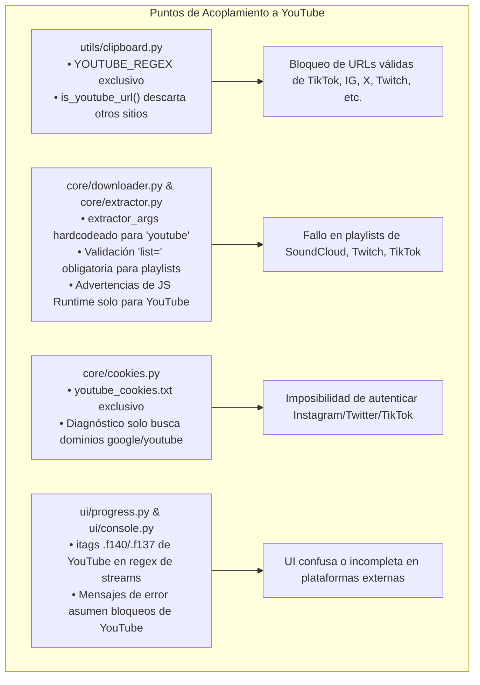
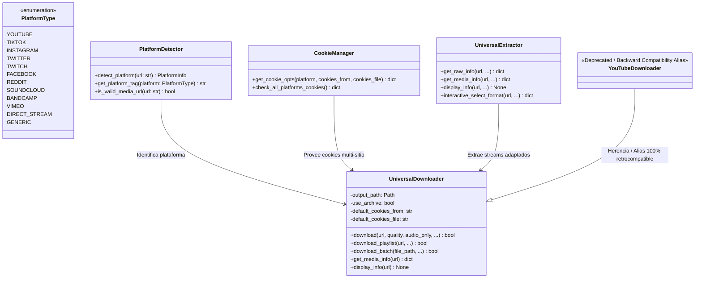
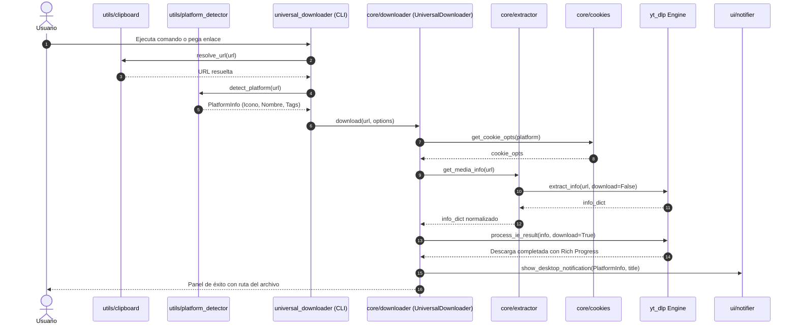
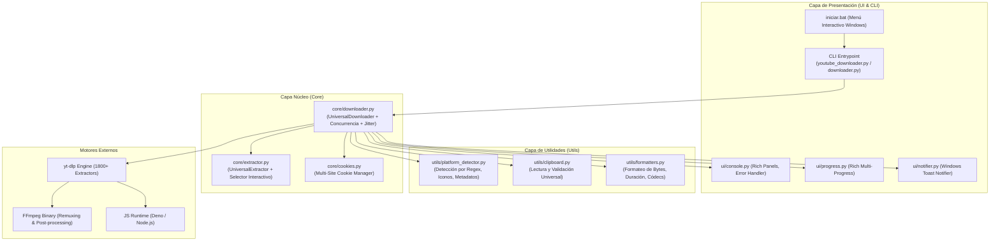

# 🌐 Análisis y Plan de Evolución: Descargador Universal de Video y Audio de Internet

> **Proyecto:** `dowloaderVid`  
> **Objetivo:** Evolucionar la herramienta desde un enfoque exclusivo de YouTube hacia un **Descargador Universal de Medios Multimedia de Alta Fidelidad** (compatible con TikTok, Instagram, Twitter/X, Twitch, Facebook, Reddit, Vimeo, SoundCloud, Bandcamp, Kick, streams HLS `.m3u8` / DASH `.mpd`, y cualquier sitio web con reproductor HTML5 soportado por `yt-dlp`).  
> **Fecha de Análisis:** Agosto 2026  
> **Estado Actual:** Arquitectura modular desacoplada en `core/`, `ui/`, `utils/`, pero con validaciones, opciones de `yt-dlp`, cookies y branding fuertemente acoplados a YouTube.

---

## 📑 Tabla de Contenidos

1. [Diagnóstico de Acoplamiento Actual a YouTube](#1-diagnóstico-de-acoplamiento-actual-a-youtube)
   - [1.1 Detección y Validación de URLs (`utils/clipboard.py`)](#11-detección-y-validación-de-urls-utilsclipboardpy)
   - [1.2 Opciones Hardcodeadas de yt-dlp (`core/downloader.py` y `core/extractor.py`)](#12-opciones-hardcodeadas-de-yt-dlp-coredownloaderpy-y-coreextractorpy)
   - [1.3 Gestión de Cookies y Autenticación (`core/cookies.py`)](#13-gestión-de-cookies-y-autenticación-corecookiespy)
   - [1.4 Detección de Streams y Barras de Progreso (`ui/progress.py`)](#14-detección-de-streams-y-barras-de-progreso-uiprogresspy)
   - [1.5 Diagnóstico de Errores y Mensajes (`ui/console.py`)](#15-diagnóstico-de-errores-y-mensajes-uiconsolepy)
   - [1.6 Menú, CLI, Scripts y Documentación](#16-menú-cli-scripts-y-documentación)
2. [Capacidades de Extracción Universal de yt-dlp](#2-capacidades-de-extracción-universal-de-yt-dlp)
   - [2.1 Plataformas Principales Soportadas y Características Clave](#21-plataformas-principales-soportadas-y-características-clave)
   - [2.2 Streams Directos M3U8 (HLS) y DASH (MPD)](#22-streams-directos-m3u8-hls-y-dash-mpd)
   - [2.3 Extractor Genérico para Páginas Web Embebidas](#23-extractor-genérico-para-páginas-web-embebidas)
3. [Arquitectura Propuesta y Especificaciones de Cambio](#3-arquitectura-propuesta-y-especificaciones-de-cambio)
   - [3.1 Módulo de Detección Dinámica de Plataformas (`utils/platform_detector.py`)](#31-módulo-de-detección-dinámica-de-plataformas-utilsplatform_detectorpy)
   - [3.2 Abstracción del Core: `UniversalDownloader` (`core/downloader.py`)](#32-abstracción-del-core-universaldownloader-coredownloaderpy)
   - [3.3 Extracción y Selector Interactivo Universal (`core/extractor.py`)](#33-extracción-y-selector-interactivo-universal-coreextractorpy)
   - [3.4 Sistema Multi-Sitio de Cookies y Autenticación (`core/cookies.py`)](#34-sistema-multi-sitio-de-cookies-y-autenticación-corecookiespy)
   - [3.5 Adaptación de UI/UX, Barras de Progreso y Notificaciones](#35-adaptación-de-uiux-barras-de-progreso-y-notificaciones)
   - [3.6 Organización Inteligente del Directorio de Salida](#36-organización-inteligente-del-directorio-de-salida)
4. [Diagramas de Arquitectura y Flujo](#4-diagramas-de-arquitectura-y-flujo)
   - [4.1 Flujo de Detección y Descarga Universal](#41-flujo-de-detección-y-descarga-universal)
   - [4.2 Diagrama de Componentes del Sistema](#42-diagrama-de-componentes-del-sistema)
5. [Matriz de Impacto vs. Esfuerzo](#5-matriz-de-impacto-vs-esfuerzo)
6. [Hoja de Ruta de Implementación (Roadmap)](#6-hoja-de-ruta-de-implementación-roadmap)

---

## 1. Diagnóstico de Acoplamiento Actual a YouTube

Tras una inspección exhaustiva de cada archivo del repositorio, se han identificado múltiples puntos donde el código restringe o asume exclusivamente el uso de YouTube.



### 1.1 Detección y Validación de URLs (`utils/clipboard.py`)

* **Ubicación:** [utils/clipboard.py:L12-22](file:///D:/videos/dowloaderVid/utils/clipboard.py#L12-L22)
* **Código actual:**
  ```python
  YOUTUBE_REGEX = re.compile(
      r'(https?://)?((www|m|music)\.)?(youtube\.com/(watch\?[^\s"\'<>]+|playlist\?[^\s"\'<>]+|shorts/[^\s"\'<>]+|live/[^\s"\'<>]+)|youtu\.be/[^\s"\'<>]+)',
      re.IGNORECASE
  )

  def is_youtube_url(url: Optional[str]) -> bool:
      if not url or not isinstance(url, str):
          return False
      return bool(YOUTUBE_REGEX.search(url.strip()))
  ```
* **Problema:** Cualquier URL que provenga de Instagram (`instagram.com/reel/...`), TikTok (`tiktok.com/@user/video/...`), Twitter/X (`x.com/.../status/...`), Twitch (`twitch.tv/videos/...`), SoundCloud, o un enlace directo `.m3u8`, es rechazada inmediatamente por `is_youtube_url()` y descartada en `get_clipboard_url()` y `resolve_url()`.
* **Impacto:** Si un usuario copia un enlace de TikTok o Instagram al portapapeles, el programa no lo detecta y obliga a escribirlo, o falla si se valida contra este regex.

### 1.2 Opciones Hardcodeadas de yt-dlp (`core/downloader.py` y `core/extractor.py`)

* **Ubicación:** [core/downloader.py:L263-267](file:///D:/videos/dowloaderVid/core/downloader.py#L263-L267), [core/extractor.py:L41-45](file:///D:/videos/dowloaderVid/core/extractor.py#L41-L45)
* **Código actual:**
  ```python
  'extractor_args': {
      'youtube': {
          'player_client': ['android', 'web', 'tv']
      }
  }
  ```
* **Problemas identificados:**
  1. **Configuración mono-extractor:** Los `extractor_args` están fijados únicamente para YouTube. Plataformas como TikTok (`tiktok: { 'app_version': ... }`), Twitter, o Twitch requieren o se benefician de sus propios parámetros de extracción.
  2. **Validación restrictiva de playlists ([core/downloader.py:L401-403](file:///D:/videos/dowloaderVid/core/downloader.py#L401-L403)):**
     ```python
     if 'playlist?list=' not in url and 'list=' not in url:
         print_error("URL no válida", "La URL debe contener 'list=' para ser una playlist válida de YouTube.")
         return False
     ```
     Esto rompe por completo la descarga de sets de SoundCloud (`soundcloud.com/artist/sets/...`), canales o colecciones de Twitch, perfiles de TikTok (`tiktok.com/@usuario`), álbumes de Bandcamp o canales de Vimeo, los cuales no usan el parámetro `list=`.
  3. **Advertencia de JS Engine fijada a YouTube ([core/downloader.py:L235-241](file:///D:/videos/dowloaderVid/core/downloader.py#L235-L241)):**
     Indica textualmente "YouTube requiere un entorno JS para resolver challenges antibot", lo cual confunde al usuario si está descargando desde Twitter, Facebook o Vimeo donde no se requiere dicho motor.

### 1.3 Gestión de Cookies y Autenticación (`core/cookies.py`)

* **Ubicación:** [core/cookies.py:L54-57](file:///D:/videos/dowloaderVid/core/cookies.py#L54-L57), [core/cookies.py:L110](file:///D:/videos/dowloaderVid/core/cookies.py#L110)
* **Código actual:**
  ```python
  # Archivo por defecto exclusivo
  local_cookies = Path('youtube_cookies.txt')

  # Diagnóstico en navegadores
  yt_cookies = len([ck for ck in jar if 'youtube' in ck.domain or 'google' in ck.domain])
  ```
* **Problemas identificados:**
  1. Solo busca `youtube_cookies.txt`. Si un usuario necesita autenticar Instagram (para ver historias o reels restringidos), Twitter/X (para ver tweets sensibles o de cuentas privadas autorizadas), TikTok, o Twitch (para suscripciones), no puede suministrar un archivo `cookies.txt` universal o por dominio.
  2. La función de diagnóstico `check_cookies_status()` solo contabiliza cookies de `youtube` y `google`. Si el navegador tiene sesión iniciada en Instagram, TikTok o Twitter, la herramienta reporta erróneamente "Sin sesión".

### 1.4 Detección de Streams y Barras de Progreso (`ui/progress.py`)

* **Ubicación:** [ui/progress.py:L68-71](file:///D:/videos/dowloaderVid/ui/progress.py#L68-L71), [ui/progress.py:L310-313](file:///D:/videos/dowloaderVid/ui/progress.py#L310-L313)
* **Código actual:**
  ```python
  if any(f in file_lower for f in ('.f140.', '.f251.', '.f250.', '.f249.', '.f139.')) or file_lower.endswith(('.m4a', '.opus')):
      stream_name = f"🎵 Audio: {short_title}"
  elif any(f in file_lower for f in ('.f137.', '.f136.', '.f298.', '.f299.', '.f313.', '.f271.', '.f134.', '.f160.')):
      stream_name = f"🎬 Video: {short_title}"
  ```
* **Problema:** Los formatos `.f140`, `.f137`, `.f251`, etc. son códigos de itag específicos de YouTube. En TikTok, Twitter, Vimeo, Twitch o streams HLS, los nombres de archivos temporales tienen extensiones y formatos diferentes (ej. `video_0.mp4`, `chunk_1.ts`, `manifest.mpd`), por lo que la clasificación visual de streams falla o cae en el fallback genérico `⬇️`.

### 1.5 Diagnóstico de Errores y Mensajes (`ui/console.py`)

* **Ubicación:** [ui/console.py:L83-93](file:///D:/videos/dowloaderVid/ui/console.py#L83-L93)
* **Código actual:**
  ```python
  elif is_403 or is_bot:
      print_error(
          "Acceso bloqueado por YouTube (403 Forbidden / Anti-Bot)",
          "YouTube requiere verificación de sesión o detectó tráfico automatizado..."
      )
  ```
* **Problema:** Todos los diagnósticos asumen YouTube. Si un enlace de Twitter requiere login o una cuenta de Instagram es privada, el error dice "Acceso bloqueado por YouTube".

### 1.6 Menú, CLI, Scripts y Documentación

* **Archivos afectados:** `iniciar.bat`, `youtube_downloader.py`, `ui/notifier.py`, `README.md`, `INICIO_RAPIDO.md`.
* **Detalles:**
  - El título de la ventana y los banners dicen `"YouTube Video Downloader CLI"`.
  - El menú en `iniciar.bat` hace referencia constante a YouTube.
  - El archivo ejecutable principal se llama `youtube_downloader.py`.

---

## 2. Capacidades de Extracción Universal de yt-dlp

`yt-dlp` es uno de los proyectos open-source más potentes para extracción de medios multimedia, con soporte para más de **1800 servicios web** y un extractor genérico con heurística avanzada para reproductores HTML5.

### 2.1 Plataformas Principales Soportadas y Características Clave

| Plataforma | Tipo de Contenidos Soportados | Capacidades Especiales en yt-dlp | Necesidad de Cookies |
| :--- | :--- | :--- | :--- |
| 🔴 **YouTube** | Videos, Shorts, Lives, Playlists, Canales, Music | Bypass anti-bot, selección 4K/8K, subtítulos multilingües | Opcional (salvo restricción de edad/403) |
| 🎵 **TikTok** | Videos, Sonidos/Audios, Perfiles, Feeds | Descarga **sin marca de agua (no-watermark)** en HD original | No (salvo cuentas privadas) |
| 📸 **Instagram** | Reels, Stories, Posts, Carruseles, IGTV | Extracción de streams MP4 directos en máxima calidad | Recomendado para Stories y perfiles |
| 🐦 **Twitter / X** | Videos nativos, Clips, Hilos, GIFs | Múltiples bitrates MP4 (H.264), transmisiones en vivo | Opcional (recomendado para NSFW / cuentas privadas) |
| 🟣 **Twitch** | VODs, Clips pasados, Streams en Vivo | Soporte para selección de calidad nativa (1080p60, 720p60) | Opcional (salvo VODs solo suscriptores) |
| 🔵 **Facebook** | Videos públicos/privados, Reels, Watch | Extracción de calidades HD y SD | Opcional para públicos, requerido para privados |
| 🟠 **Reddit** | Videos en `v.redd.it`, posts con video | Combinación automática de stream de audio y video separado | No |
| ☁️ **SoundCloud** | Pistas individuales, Álbumes, Playlists, Sets | Audio HQ (MP3/Opus/AAC), metadatos completos y carátula | No |
| 🎸 **Bandcamp** | Canciones, Discografías completas, Álbumes | Flujos directos MP3/FLAC con carátula y metadatos de autor | No |
| 🔷 **Vimeo** | Videos HD/4K, Showcases, Canales | Selección de bitrate adaptable y subtítulos | Opcional |
| 📌 **Pinterest** | Videos de pines, Story Pins | Extracción de stream MP4 directo en máxima resolución | No |
| 🟢 **Kick** | Clips, VODs, Transmisiones en directo | Soporte de HLS con fragmentos paralelos | No |
| 📺 **Rumble / Bilibili / Dailymotion** | Videos, Canales, Transmisiones | Extracción multi-resolución y soporte multi-audio | No |

### 2.2 Streams Directos M3U8 (HLS) y DASH (MPD)

`yt-dlp` maneja nativamente enlaces que apuntan directamente a listas de reproducción HLS (`.m3u8`) o manifiestos DASH (`.mpd`):
* **Descarga Fragmentada Paralela:** Utiliza `--concurrent-fragments` (actualmente configurado en 6 en nuestro proyecto) para acelerar la descarga de segmentos `.ts` o `.m4s`.
* **Combinación sin pérdida:** FFmpeg ensambla y remuxea los paquetes de transporte (`transport stream`) a contenedores estándar `.mp4` o `.mkv` sin recodificación innecesaria.
* **Captura de Transmisiones en Vivo (Livestreams):** Permite grabar streams en directo desde el inicio o en tiempo real.

### 2.3 Extractor Genérico para Páginas Web Embebidas

Para sitios web que no cuentan con un extractor especializado (blogs de noticias, plataformas educativas, reproductores web como Video.js, JWPlayer, Plyr, o etiquetas `<video src="...">`), `yt-dlp` incluye el **Generic Extractor**:
* Analiza el DOM HTML, etiquetas `<video>`, `<audio>`, metadatos OpenGraph (`og:video`), esquemas JSON-LD y scripts JavaScript en busca de URLs de manifiestos `.m3u8`, `.mpd` o archivos `.mp4`/`.webm`.
* Se activa automáticamente ante cualquier URL HTTP/HTTPS que no coincida con extractores específicos.

---

## 3. Arquitectura Propuesta y Especificaciones de Cambio

Para transformar el proyecto en un descargador universal sin perder la velocidad, elegancia ni compatibilidad regresiva, se propone la siguiente arquitectura:



### 3.1 Módulo de Detección Dinámica de Plataformas (`utils/platform_detector.py`)

Crear un módulo especializado en la identificación de plataformas para personalizar la interfaz, los iconos de Rich, la carpeta de destino y los parámetros de extracción.

#### Especificación Técnica:
```python
from dataclasses import dataclass
from enum import Enum
import re
from typing import Optional

class PlatformType(Enum):
    YOUTUBE = "youtube"
    TIKTOK = "tiktok"
    INSTAGRAM = "instagram"
    TWITTER = "twitter"
    TWITCH = "twitch"
    FACEBOOK = "facebook"
    REDDIT = "reddit"
    SOUNDCLOUD = "soundcloud"
    BANDCAMP = "bandcamp"
    VIMEO = "vimeo"
    DIRECT_STREAM = "direct_stream"
    GENERIC = "generic"

@dataclass
class PlatformInfo:
    type: PlatformType
    name: str
    icon: str
    color: str
    supports_playlists: bool
    recommended_audio_fmt: str

# Mapeo de patrones de URL
PLATFORM_PATTERNS = [
    (r'(youtube\.com|youtu\.be)', PlatformInfo(PlatformType.YOUTUBE, "YouTube", "🔴", "red", True, "mp3")),
    (r'(tiktok\.com)', PlatformInfo(PlatformType.TIKTOK, "TikTok", "🎵", "magenta", True, "mp3")),
    (r'(instagram\.com)', PlatformInfo(PlatformType.INSTAGRAM, "Instagram", "📸", "bright_magenta", True, "m4a")),
    (r'(twitter\.com|x\.com)', PlatformInfo(PlatformType.TWITTER, "Twitter / X", "🐦", "blue", False, "mp3")),
    (r'(twitch\.tv)', PlatformInfo(PlatformType.TWITCH, "Twitch", "🟣", "bright_blue", True, "mp3")),
    (r'(facebook\.com|fb\.watch)', PlatformInfo(PlatformType.FACEBOOK, "Facebook", "🔵", "blue", True, "mp3")),
    (r'(reddit\.com|v\.redd\.it)', PlatformInfo(PlatformType.REDDIT, "Reddit", "🟠", "bright_red", False, "mp3")),
    (r'(soundcloud\.com)', PlatformInfo(PlatformType.SOUNDCLOUD, "SoundCloud", "☁️", "yellow", True, "mp3")),
    (r'(bandcamp\.com)', PlatformInfo(PlatformType.BANDCAMP, "Bandcamp", "🎸", "cyan", True, "flac")),
    (r'(vimeo\.com)', PlatformInfo(PlatformType.VIMEO, "Vimeo", "🔷", "bright_cyan", True, "mp3")),
    (r'(\.m3u8|\.mpd|\.mp4|\.webm|\.m4a|\.mp3)($|\?)', PlatformInfo(PlatformType.DIRECT_STREAM, "Stream Directo", "📡", "green", False, "mp3")),
]
```

#### Actualización de `utils/clipboard.py`:
- Reemplazar `is_youtube_url()` por `is_valid_media_url(url: str) -> bool` que valide cualquier URL `http://` o `https://` bien formada.
- Mantener `is_youtube_url()` como wrapper para no romper tests ni código legado.
- Modificar `get_clipboard_url()` para capturar cualquier enlace multimedia válido.

### 3.2 Abstracción del Core: `UniversalDownloader` (`core/downloader.py`)

1. **Renombrar la clase principal:**
   - Crear la clase `UniversalDownloader` (o `MediaDownloader`).
   - Crear el alias de compatibilidad en el mismo archivo y en `core/__init__.py`:
     ```python
     YouTubeDownloader = UniversalDownloader
     ```
2. **Desacoplamiento de `extractor_args`:**
   - Inyectar `extractor_args` dinámicamente según la plataforma detectada:
     ```python
     def _get_extractor_args(self, platform: PlatformType) -> Dict[str, Any]:
         args = {}
         if platform == PlatformType.YOUTUBE:
             args['youtube'] = {'player_client': ['android', 'web', 'tv']}
         elif platform == PlatformType.TIKTOK:
             args['tiktok'] = {'app_version': 'latest'}
         return args
     ```
3. **Soporte de Playlists y Listas Multi-Plataforma:**
   - Eliminar la validación restrictiva `if 'list=' not in url`.
   - Utilizar el modo `extract_flat=True` de `yt-dlp` para cualquier plataforma: si `_type == 'playlist'` o `'entries' in info`, se procesa como lista sin importar el dominio.

### 3.3 Extracción y Selector Interactivo Universal (`core/extractor.py`)

1. **Detección de Formatos No-YouTube:**
   - Muchas plataformas (TikTok, Instagram, Twitter) ofrecen streams combinados progresivos (`vcodec != 'none'` y `acodec != 'none'`) o formatos directos con resoluciones variables.
   - En Twitch y streams HLS, los formatos vienen etiquetados como `1080p60 (source)`, `720p60`, `480p`, etc.
   - El selector interactivo `interactive_select_format` debe:
     - Identificar streams progresivos y mostrarlos limpiamente.
     - Identificar streams directos de audio (SoundCloud / Bandcamp) y saltar automáticamente la selección de video para ofrecer opciones de audio.
     - Mostrar el badge de la plataforma detectada en el encabezado del panel:
       `🎬 Selector Interactivo - 🎵 TikTok: @usuario/video`

### 3.4 Sistema Multi-Sitio de Cookies y Autenticación (`core/cookies.py`)

1. **Jerarquía de Archivos de Cookies:**
   - Archivo genérico: `cookies.txt` (estándar de la industria).
   - Archivos por plataforma si existen:
     - `youtube_cookies.txt`
     - `instagram_cookies.txt`
     - `tiktok_cookies.txt`
     - `twitter_cookies.txt`
   - Si no se especifica uno, buscar primero el archivo específico de la plataforma, luego `cookies.txt`, luego el local histórico `youtube_cookies.txt`.
2. **Diagnóstico Multi-Plataforma en Navegadores (`check_cookies_status`):**
   - Comprobar sesiones no solo para YouTube/Google, sino también para:
     - Instagram (`instagram.com`)
     - TikTok (`tiktok.com`)
     - Twitter / X (`twitter.com`, `x.com`)
     - Twitch (`twitch.tv`)
     - Facebook (`facebook.com`)
     - Reddit (`reddit.com`)

### 3.5 Adaptación de UI/UX, Barras de Progreso y Notificaciones

1. **UI en `ui/console.py`:**
   - Banners neutrales y modernos: `"🌐 Universal Video & Audio Downloader CLI"`.
   - Diagnósticos de error dinámicos:
     - Error 403 / Login en Instagram -> Sugerir `--cookies-from` o `instagram_cookies.txt`.
     - Error en Twitter/X -> Sugerir sesión de navegador.
     - Error en YouTube -> Sugerir Deno/Node.js y cookies.
2. **Barras de Progreso en `ui/progress.py`:**
   - Adaptar los regex de streams para reconocer streams genéricos:
     - Si el archivo contiene `.audio.`, `.m4a`, `.mp3`, `.opus` -> `🎵 Audio`
     - Si contiene `.video.`, `.mp4`, `.webm` -> `🎬 Video`
     - Si es stream HLS/DASH -> `📡 Stream (Fragmentos)`
3. **Notificaciones en `ui/notifier.py`:**
   - App ID genérico: `"Universal Media Downloader"`.
   - Títulos dinámicos con el icono de la plataforma: `"🎵 TikTok Descargado"`, `"📸 Reel de Instagram Guardado"`, `"🎬 Video Descargado"`.

### 3.6 Organización Inteligente del Directorio de Salida

Se propone estructurar las descargas por defecto separando por tipo o por plataforma, configurable por el usuario:

```
Descargas/
├── Videos/
│   ├── YouTube/
│   ├── TikTok/
│   ├── Instagram/
│   ├── Twitter/
│   └── Twitch/
├── Audios/
│   ├── SoundCloud/
│   ├── Bandcamp/
│   └── YouTube/
├── Playlists/
└── .download_archive.txt
```

---

## 4. Diagramas de Arquitectura y Flujo

### 4.1 Flujo de Detección y Descarga Universal



### 4.2 Diagrama de Componentes del Sistema



---

## 5. Matriz de Impacto vs. Esfuerzo

| Módulo / Cambio | Impacto | Esfuerzo | Prioridad | Beneficio Principal |
| :--- | :---: | :---: | :---: | :--- |
| **Desacoplamiento de Regex en `utils/clipboard.py`** | 🔴 Alto | 🟢 Bajo | **P0 (Inmediata)** | Permite pegar y resolver URLs de cualquier plataforma de inmediato. |
| **Módulo de Detección `utils/platform_detector.py`** | 🔴 Alto | 🟢 Bajo | **P0 (Inmediata)** | Identifica la plataforma, aplica íconos Rich y configuraciones personalizadas. |
| **Abstracción del Core `UniversalDownloader`** | 🔴 Alto | 🟡 Medio | **P0 (Inmediata)** | Desacopla `extractor_args`, flexibiliza playlists y mantiene 100% retrocompatibilidad. |
| **Adaptación del Selector Interactivo (`core/extractor.py`)** | 🟡 Medio | 🟡 Medio | **P1 (Alta)** | Muestra streams progresivos y directos de TikTok/Instagram/Twitter y HLS de Twitch. |
| **Gestión Multi-Sitio de Cookies (`core/cookies.py`)** | 🟡 Medio | 🟡 Medio | **P1 (Alta)** | Autentica cuentas de Instagram, Twitter, TikTok y Twitch para contenido restringido. |
| **Actualización de UI/UX, Banners y Notificaciones** | 🟢 Menor | 🟢 Bajo | **P2 (Media)** | Mejora la experiencia visual con estética universal e iconos por plataforma. |
| **Actualización del Menú `iniciar.bat` y Scripts** | 🟡 Medio | 🟢 Bajo | **P2 (Media)** | Ofrece un menú interactivo intuitivo que refleja el soporte multi-plataforma. |
| **Organización de Salida por Plataformas (`Descargas/TikTok`, etc.)** | 🟢 Menor | 🟢 Bajo | **P3 (Opcional)** | Mantiene el directorio de descargas ordenado y clasificado por servicio. |

---

## 6. Hoja de Ruta de Implementación (Roadmap)

La evolución se estructura en **5 fases ordenadas por prioridad técnica y dependencia**, garantizando que el sistema sea 100% funcional en cada paso:

### 🚀 Fase 1: Desacoplamiento de Validaciones y Soporte Multi-Plataforma Base
* [x] **Crear `utils/platform_detector.py`:**
  - Definir `PlatformType`, `PlatformInfo` y el mapeo de expresiones regulares para YouTube, TikTok, Instagram, Twitter/X, Twitch, Facebook, Reddit, SoundCloud, Bandcamp, Vimeo, Streams Directos y Web Genérica.
  - Implementar `detect_platform(url)` y funciones auxiliares de etiquetado visual Rich.
* [x] **Refactorizar `utils/clipboard.py`:**
  - Implementar `is_valid_media_url(url)` con soporte para cualquier URL HTTP/HTTPS.
  - Actualizar `get_clipboard_url()` y `resolve_url()` para no restringir a YouTube.
  - Mantener `is_youtube_url()` como función delegada retrocompatible.
* [x] **Actualizar pruebas unitarias de utilidades:**
  - Agregar pruebas para URLs de TikTok, Instagram, Twitter, Twitch, SoundCloud y streams directos.

### ⚙️ Fase 2: Abstracción del Core (`UniversalDownloader`) y Extractor Universal
* [x] **Refactorizar `core/downloader.py`:**
  - Renombrar la clase principal a `UniversalDownloader` y definir `YouTubeDownloader = UniversalDownloader`.
  - Dinamizar `extractor_args` según la plataforma detectada.
  - Eliminar la validación estricta de `list=` en `download_playlist()`, permitiendo listas de SoundCloud, Twitch, TikTok, etc.
  - Ajustar las advertencias de JS Engine para que solo se muestren en plataformas que realmente lo requieran.
* [x] **Refactorizar `core/extractor.py`:**
  - Adaptar `interactive_select_format()` para procesar streams progresivos únicos (TikTok/Instagram) y streams HLS (Twitch).
  - Normalizar el extractor para contenidos que solo tienen pista de audio (SoundCloud/Bandcamp).

### 🍪 Fase 3: Cookies Multi-Sitio y Manejo de Autenticación
* [x] **Actualizar `core/cookies.py`:**
  - Soporte de búsqueda en cascada: `cookies_[plataforma].txt` -> `cookies.txt` -> `youtube_cookies.txt`.
  - Extender `check_cookies_status()` para auditar sesiones activas de Instagram, Twitter, TikTok, Twitch, Facebook y Reddit en los navegadores instalados.
  - Actualizar la guía de cookies para explicar cómo exportar credenciales de otras redes sociales.

### 🎨 Fase 4: UI/UX Adaptativa, Notificaciones y Organización de Archivos
* [x] **Actualizar `ui/console.py` y `ui/notifier.py`:**
  - Banners actualizados a *"Universal Media Downloader"*.
  - Diagnóstico de errores contextual según la plataforma (errores específicos de Instagram, Twitter, etc.).
  - Notificaciones nativas con el nombre e icono de la plataforma.
* [x] **Actualizar `ui/progress.py`:**
  - Detección universal de tipos de archivo en hooks de progreso (sin depender de itags de YouTube).
* [x] **Organización opcional de carpetas:**
  - Soporte para subcarpetas automáticas por plataforma (`Descargas/TikTok/`, `Descargas/Instagram/`, etc.) o por tipo (`Videos/`, `Audios/`).

### 📦 Fase 5: Entrypoints, Menú Interactivo (`iniciar.bat`), Documentación y Tests
* [x] **Actualizar Entrypoints:**
  - Mantener `youtube_downloader.py` como CLI completo con soporte para todos los nuevos comandos y plataformas.
  - Opcional: Crear symlink/wrapper `downloader.py` o `media_downloader.py`.
* [x] **Actualizar `iniciar.bat`:**
  - Rediseñar el menú para reflejar el soporte universal (TikTok, Instagram, Twitter, Twitch, Playlists, Streams).
* [x] **Actualizar Documentación:**
  - Actualizar `README.md`, `INICIO_RAPIDO.md` e `INSTALACION.md` con ejemplos de descarga para TikTok, Instagram, Twitter, Twitch, SoundCloud y streams HLS.
* [x] **Ejecutar Suite de Pruebas Completa:**
  - Ejecutar y verificar `tests/test_modular_downloader.py` asegurando 100% de tests aprobados.

---

## 7. Conclusión del Análisis

El proyecto actual cuenta con una **excelente base arquitectónica** (código modular en `core/`, `ui/`, `utils/`, soporte multihilo con `ThreadPoolExecutor`, barras de progreso Rich y notificaciones nativas). Sin embargo, se encuentra artificialmente limitado a YouTube debido a validaciones regex, nombres de archivos de cookies y opciones hardcodeadas.

La transición a un **Descargador Universal de Medios** es totalmente viable, de bajo riesgo técnico y de alto impacto funcional, aprovechando el potencial nativo de `yt-dlp` (más de 1800 servicios) con una experiencia de usuario de primera clase.
