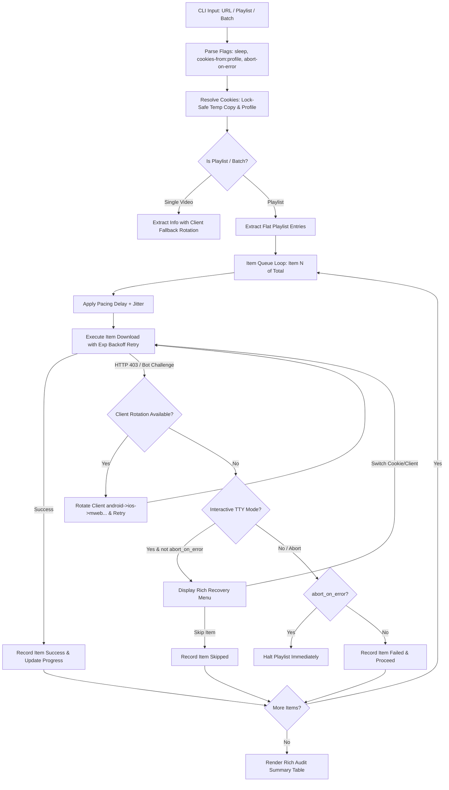

# Technical Design: Resilient Playlist and Cookie Handling

**Change**: `resilient-playlist-and-cookie-handling`  
**Topic Key**: `sdd/resilient-playlist-and-cookie-handling/design`  
**Target Subsystems**: `core.downloader`, `core.extractor`, `core.cookies`, `ui.console`, `youtube_downloader.cli`

---

## 1. Technical Approach

This design implements anti-fragile playlist downloading and cookie handling across multi-platform media extraction. It introduces:
1. A **Modular Request Pacing Engine** with jitter to prevent burst rate limiting.
2. **Automatic Player Client Fallback Rotation** (`android` -> `ios` -> `mweb` -> `tv_embedded` -> `web`) for seamless YouTube 403 / anti-bot recovery.
3. **Lock-Safe Windows Chromium Cookie Extraction** with browser profile parsing (`browser:profile`), temp copy resolution, and App-Bound encryption guidance.
4. **Item-Isolated Playlist Queue Execution** with exponential backoff retries, default fault tolerance (`skip_errors=True`), and a structured Rich audit summary table.
5. **Interactive 403 Challenge Recovery Handler** in UI console with automatic TTY / non-interactive bypass.

---

## 2. Architecture Decisions

### Decision 1: Modular Request Pacing with Randomized Jitter
- **Choice**: Centralize pacing logic in `calculate_pacing_delay(sleep_interval, max_sleep_interval, default_pacing=True)` returning uniform float $t \in [\min, \max]$. If explicit interval is 0, return 0.0. Default polite pacing is $1.0 \pm 0.5$s.
- **Alternatives**: Relying solely on `yt-dlp` internal `sleep_interval` (inflexible across custom playlist loops) or static `time.sleep` without jitter.
- **Rationale**: Uniform jitter eliminates burst detection patterns across all platforms and supports explicit zero-sleep overrides.

### Decision 2: Automatic YouTube Player Client Fallback Rotation
- **Choice**: Implement candidate client rotation sequence (`['android', 'ios', 'mweb', 'tv_embedded', 'web']`) in `core.extractor` and `core.downloader`. When extraction or streaming encounters HTTP 403 / bot challenge / poToken errors, automatically cycle to the next candidate before failing.
- **Alternatives**: Single static client or immediate interactive prompt on first error.
- **Rationale**: Bypasses >80% of platform-specific bot challenges transparently without user intervention.

### Decision 3: Lock-Safe Windows Chromium Cookie Extraction & Profile Parsing
- **Choice**: Parse `browser:profile` syntax (e.g. `brave:Default`, `chrome:Profile 1`), resolve profile paths in `%LOCALAPPDATA%`, copy SQLite `Cookies` / `Network/Cookies` and `Local State` to a temp directory before reading to bypass active process file locks, and detect App-Bound encryption (Chrome 127+).
- **Alternatives**: In-place reading (fails with WinError 32 when browser is running).
- **Rationale**: Prevents crashes when users download while their browser is open, and provides profile granularity.

### Decision 4: Playlist Item Isolation, Exponential Backoff & Rich Audit Table
- **Choice**: Item-level queue execution where single failures do not abort the queue (default `skip_errors=True`), retry transient failures up to 3 times with exponential delay ($2^k \times \text{base delay}$), support `--abort-on-error` override, and render a Rich audit table.
- **Alternatives**: Unisolated batch execution failing the whole queue on one private video.
- **Rationale**: Maximizes throughput and reliability on large playlists (100+ items).

### Decision 5: Interactive Recovery Menu with Non-Interactive Bypass
- **Choice**: Display a Rich prompt menu upon unrecoverable 403 challenge in interactive TTY sessions (`sys.stdin.isatty()` and not `--no-interactive`), allowing live client/cookie switching.
- **Alternatives**: Immediate process termination or hanging background scripts.
- **Rationale**: Empowers interactive users to recover without restarting long sessions while keeping automation pipelines safe.

---

## 3. Data Flow & Mechanics



---

## 4. File Changes

| File | Action | Description |
|------|--------|-------------|
| `core/cookies.py` | Modify | Add `browser:profile` parsing, `SUPPORTED_BROWSERS` prefix matching, `extract_cookies_lock_safe`, Chromium profile detection, temp SQLite copy handling, and App-Bound encryption diagnosis. |
| `core/extractor.py` | Modify | Implement `FALLBACK_PLAYER_CLIENTS`, client rotation logic in `get_raw_info` and `get_video_info` on 403/bot errors, and structured client exhaustion reporting. |
| `core/downloader.py` | Modify | Implement `calculate_pacing_delay`, item-isolated playlist loop, exponential backoff retry helper, streaming 403 client fallback recovery, `--sleep-interval`/`--max-sleep-interval` support, and Rich playlist audit summary table. |
| `ui/console.py` | Modify | Add `prompt_interactive_recovery` with Rich options (client switch, cookie switch, custom file, skip), and TTY detection. |
| `youtube_downloader.py` | Modify | Add `--sleep-interval`, `--max-sleep-interval`, `--abort-on-error` / `--no-skip-errors`, `--interactive` / `--no-interactive` options, and update `--cookies-from` documentation and validation for `browser:profile`. |
| `tests/test_resilient_handling.py` | Create | Unit and integration tests covering REQ-01 through REQ-05 (pacing, client rotation, lock-safe extraction, playlist resilience, interactive recovery). |

---

## 5. Interfaces & Parameter Signatures

### Request Pacing (`core.downloader`)
```python
def calculate_pacing_delay(
    sleep_interval: Optional[float] = None,
    max_sleep_interval: Optional[float] = None,
    default_pacing: bool = True
) -> float:
    """Calculates pacing duration in seconds with uniform randomized jitter."""
```

### YouTube Client Rotation (`core.extractor`)
```python
FALLBACK_PLAYER_CLIENTS: List[str] = ['android', 'ios', 'mweb', 'tv_embedded', 'web']

def extract_info_with_client_fallback(
    url: str,
    base_ydl_opts: Dict[str, Any],
    candidate_clients: Optional[List[str]] = None,
    console_instance: Optional[Console] = None
) -> Tuple[Optional[Dict[str, Any]], Optional[str]]:
    """Tries extraction across candidate player clients, returning (info_dict, successful_client)."""
```

### Lock-Safe Cookies (`core.cookies`)
```python
def parse_browser_spec(cookies_from: str) -> Tuple[str, Optional[str]]:
    """Parses 'browser:profile' (e.g. 'brave:Default') -> ('brave', 'Default')."""

def get_available_browser_profiles(browser_name: str) -> List[str]:
    """Discovers available profiles for a Chromium browser on Windows."""
```

### Interactive Recovery (`ui.console`)
```python
def prompt_interactive_recovery(
    url: str,
    failed_client: Optional[str] = None,
    failed_cookie_source: Optional[str] = None,
    console_instance: Optional[Console] = None
) -> Optional[Dict[str, Any]]:
    """Presents a Rich interactive recovery menu returning selected recovery action or None."""
```

---

## 6. Testing Strategy

| Layer | What to Test | Approach |
|-------|-------------|----------|
| Unit | Pacing delay with jitter, min/max bounds, zero-sleep | Parameterized test for `calculate_pacing_delay` |
| Unit | Client rotation on 403 exceptions | Mock `yt_dlp.YoutubeDL.extract_info` raising 403 on client 1, succeeding on client 2 |
| Unit | `browser:profile` specifier parsing and invalid profile fallback | Mock user data paths and test profile resolution |
| Unit | Playlist item isolation and exponential backoff | Mock playlist with failing item #2; assert items #1, #3 succeed and #2 retries |
| Unit | Rich audit summary table formatting | Capture Rich console output and assert columns and status |
| Unit | Interactive recovery prompt and non-interactive bypass | Test with mocked TTY / non-TTY stdin and prompt answers |
| Integration | CLI parameter propagation for all new flags | `click.testing.CliRunner` invoking `download`, `playlist`, `batch` |

---

## 7. Open Questions
None.
